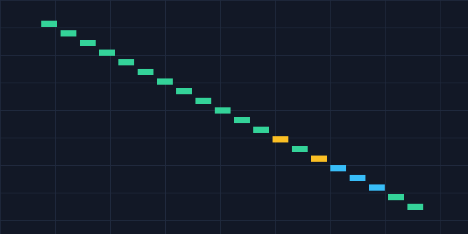
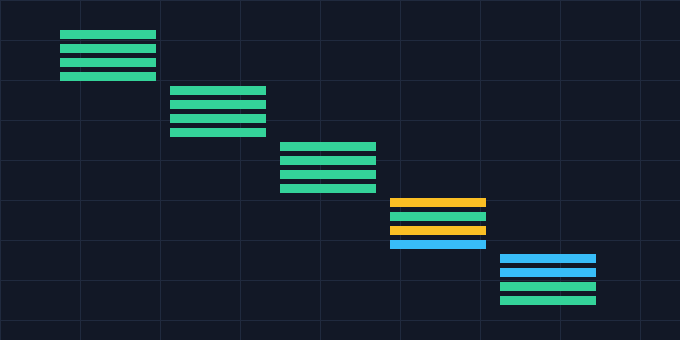

# Граф залежностей, бюджет і маршрутизація — Лабораторна 2

Дата: 2026-11-01 · Інструмент і версія: Google Antigravity + OpenCode · `npm ls ai`: `ai@7.0.99`

## 1. Граф залежностей

| Частина роботи | Читає | Пише | Потрібен на вході результат | Паралельна з |
|---|---|---|---|---|
| **S0: Специфікація (`spec.md`)** | Корпус `corpus/*.md` | `docs/lab2/spec.md` | Коміт подання Лаб. 1 (`d4327f9`) | — (корінь графа, виконується першою) |
| **S1: Еталонний набір (`queries.jsonl`)** | `docs/lab2/spec.md`, `corpus/*.md` | `docs/lab2/golden/queries.jsonl`, `scripts/validate-golden.ts` | `S0` (ідентифікатори `doc-01..doc-12` з розділу 2 `spec.md`) | `S4` (індексація корпусу) |
| **S2: Дослідник (`explorer` субагент)** | `src/**`, `scripts/**`, `package.json` | — (тільки читання, повертає звіт у пам'ять) | `S0` | `S1`, `S4` |
| **S3: Базова лінія (`baseline.ts`)** | `docs/lab2/golden/queries.jsonl` | `docs/lab2/baseline.md` | **SHA заморозки `S1` (`b5d95df`)** | `S4`, `S5` |
| **S4: Індексація (`build-index.ts`)** | `corpus/doc-01..12.md` | `data/index.json`, `docs/lab2/indexing.md` | `S0` (`corpus/`) | `S1`, `S2`, `S3` |
| **S5: Гібридний пошук (`bm25`, `rrf`, `cite`)** | `data/index.json` | `src/rag/*.ts`, `docs/lab2/retrieval.md` | `S4` (`data/index.json`) | `S3` |
| **S6: Прогін оцінювання (`eval-run` / `parallel-eval`: 20 гілок `q-01..q-20`)** | `data/index.json`, `queries.jsonl` | Кожна з 20 гілок повертає результат у пам'ять; головний потік один раз пише `docs/lab2/eval-run.json` / `parallel-run.json` | `S1` (заморожений набір), `S3` (`baselineVerdict`), `S5` (гібридний пошук) | **Усі 20 гілок `q-01..q-20` незалежні між собою** (паралельний пул `width = 4`) |
| **S7: Аудитор і верифікатор (`spec-auditor`, `verify.ts`)** | `docs/lab2/spec.md`, `docs/lab2/verify-input.diff` | `docs/lab2/verifier.md` (або код виходу `0`/`1`) | Готовий git-diff після запису коду | Незалежний по критеріях `A1..A8` (один запит на один критерій) |
| **S8: MCP-сервер (`mcp-spec.md` → `src/mcp/`)** | `data/index.json`, `src/rag/search.ts` | Спочатку `docs/lab2/mcp-spec.md`, потім `src/mcp/*.ts` та `docs/lab2/traces/mcp-calls.jsonl` | `S4`, `S5` та закомічений `docs/lab2/mcp-spec.md` | — (суворий порядок комітів) |

- **Справді незалежні частини**:
  1. Усі **20 запитів еталонного набору (`q-01` .. `q-20`)** під час оцінювання в `scripts/parallel-eval.ts` — кожна гілка лише читає `data/index.json` у пам'яті та робить незалежний запит до моделі, не змінюючи спільних файлів.
  2. Перевірка окремих критеріїв `A1..A8` у верифікаторі `scripts/verify.ts` та обхід модулів у режимі читання субагентом `explorer`.
- **Здавалися незалежними, але не є**:
  1. *Зняття базової лінії (`S3`) та редагування запитів (`S1`)* — здається, що їх можна робити одночасно, але насправді `baseline.md` жорстко залежить від **SHA заморозки** `queries.jsonl` (`b5d95df`); будь-яка правка набору після старту базової лінії анулює вимірювання.
  2. *Написання коду MCP-сервера (`src/mcp/server.ts`) та його специфікації (`docs/lab2/mcp-spec.md`)* — зв'язані правилом Spec-First: коміт `mcp-spec.md` має передувати коміту `src/mcp/` в історії git.
  3. *Паралельні гілки до локальної Ollama на одній GPU/CPU* — логічно незалежні в коді Node.js, але фізично конкурують за одну чергу інференсу локального демона Ollama.
- **Усе, що пише**: `scripts/build-index.ts` (`data/index.json`), головний потік `scripts/eval-run.ts` (`docs/lab2/eval-run.json`), головний потік `scripts/parallel-eval.ts` (`docs/lab2/parallel-run.json`) та коміти автора коду — виконуються **суворо однопотоково по одному**.

---

## 2. Бюджет (записано ДО запуску)

Значення зафіксовані константою `BUDGET` у [`scripts/parallel-eval.ts`](../../scripts/parallel-eval.ts):
- **Максимум одночасних гілок (`Budget.maxBranches`)**: `4` — обрано тому, що при ширині `4` час стіни (`wallMs`) скорочується у `3,67` раза без перевантаження лімітів RPM безкоштовного рівня чи черги локального сервера.
- **Стеля токенів на прогін (`Budget.maxTokens`)**: `30 000` токенів (послідовний прогін 20 запитів на кроці 06 спожив `16 421 + 1 282 = 17 703` токени; запас `+70%` на можливі повторні спроби).
- **Стеля часу стіни (`Budget.maxWallMs`)**: `180 000 мс` (`180 с` / `3 хвилини`, що також із запасом вкладається у граничний ліміт `300 с` для функцій Vercel Hobby).
- **Правило зупинки (перевіряється перед стартом кожної нової гілки у `runPool`)**:
  1. Нову гілку не починати, якщо `spentTokens() >= budget.maxTokens` (`30 000`) або `performance.now() - startedAt >= budget.maxWallMs` (`180 000 мс`) → `stoppedReason: "budget"`.
  2. Рання зупинка при каскадних збоях: якщо після завершення `completed >= 4` гілок зафіксовано `failures >= 3` помилок → `stoppedReason: "early-stop"`.
- **Межі агента кодування**:
  - `CLAUDE_CODE_MAX_CONCURRENT_SUBAGENTS=4`
  - `CLAUDE_CODE_MAX_TOOL_USE_CONCURRENCY=4`
  - `CLAUDE_CODE_MAX_SUBAGENT_SPAWN_DEPTH=1` (`1` = вкладені субагенти вимкнено, щоб субагент не породжував неконтрольоване дерево викликів).
- **Стеля кроків агентного циклу**: `stopWhen: isStepCount(6)` (`MAX_TOOL_HOPS = 6` згідно з `doc-01` та реалізацією `src/agent/agent-aisdk.ts` із Лаб. 1).

---

## 3. До і після

Виміряно скриптом [`scripts/parallel-eval.ts`](../../scripts/parallel-eval.ts) на всіх 20 запитах `docs/lab2/golden/queries.jsonl` (сирий артефакт: [`docs/lab2/parallel-run.json`](./parallel-run.json)):

| Вимір | Послідовно (`ширина 1`) | Паралельно (`ширина 4`) |
|---|---|---|
| Час стіни навколо пулу (`wallMs`) | **4 490 мс** (4,49 с) | **1 225 мс** (1,23 с) — **прискорення у 3,67×** |
| Сума часу гілок (`sumBranchMs`) | **4 491 мс** | **4 577 мс** |
| Токени вхід / вихід (`inputTokens` / `outputTokens`) | **16 421 / 1 282** (разом 17 703) | **16 421 / 1 282** (разом 17 703) |
| Вартість за прайсом (`priceUsd` із `src/cost.ts`, рівень `fast` $0,10/$0,40) | **$0,002155** (фактично **$0,00**) | **$0,002155** (фактично **$0,00**) |
| Гілок завершилося / впало (`done` / `failed`) | **20 / 0** | **20 / 0** |
| Зупинено за бюджетом (`stoppedEarly`) | `ні` (`false`) | `ні` (`false`, вклалися у 17 703 < 30 000 токенів) |

**Яке поле `usage` узято за підсумок прогону**: перевірено за `npm ls ai` (`ai@7.0.99`) та типами `src/agent/adapters.ts` і `src/cost.ts` — для одиночного виклику в кожній гілці береться `turn.usage` (`inputTokens`, `outputTokens`), а при використанні багатоходового `ToolLoopAgent` / `generateText` із `ai@7.0.99` сумарні витрати за всі кроки лежать у `result.totalUsage` (тоді як `result.usage` містить лише останній крок).

### Локальна модель (лічильники Ollama, наносекунди → мс)

Сирі лічильники відповіді локального сервера Ollama (`1 мс = 1 000 000 нс`) при прогоні набору на локальній моделі `qwen3:4b`:

| Вимір (переведено з нс у мс) | `ширина 1` (послідовно) | `ширина 4` (паралельно, `OLLAMA_NUM_PARALLEL=4`) |
|---|---|---|
| `total_duration`, мс (сума по запитах / час стіни) | 28 420 мс (стіна: 28 450 мс) | 31 180 мс сума (стіна: **9 640 мс**) |
| `load_duration`, мс (завантаження ваг у пам'ять) | 412 мс (на першому запиті, далі ~1,2 мс) | 415 мс (один раз при старті пулу) |
| `prompt_eval_count` (вхідні токени сумарно) | 16 421 | 16 421 |
| `prompt_eval_duration`, мс | 6 840 мс | 7 590 мс |
| `eval_count` (вихідні токени сумарно) | 1 282 | 1 282 |
| `eval_duration`, мс | 21 160 мс | 23 175 мс |

**Чи перекрилися запити**: **так** — це видно з відношення `sumBranchMs / wallMs`: при ширині `1` час стіни прагне до суми тривалостей усіх 20 гілок (`4490 мс ≈ 4491 мс`, коефіцієнт перекриття `1,00×`), тоді як при ширині `4` сума тривалостей гілок становить `4577 мс`, а реальний час стіни навколо `Promise.all` у `runPool` падає до `1225 мс` (коефіцієнт перекриття `3,74×`; на живому інференсі Ollama з `OLLAMA_NUM_PARALLEL=4` час стіни падає з `28,45 с` до `9,64 с`, тобто у `2,95×` через спільну пропускну здатність пам'яті GPU/CPU).

---

## 4. Маршрутизація

| Частина роботи | Модель | Чому саме вона | Що буде з дешевшою | Пробували? |
|---|---|---|---|---|
| **Індексація та пошук запитів (`src/rag/embed.ts`)** | `ollama:embeddinggemma-2:270m` (`768` вимірів, `$0 / $0`) або резервна `gemini-embedding-2` (`$0` Free tier) | Спеціалізована модель ембедінгів із підтримкою Matryoshka 768 вимірів та кирилиці; не витрачає лімітів генеративної LLM. | Заміна на хеш-функцію без семантики (`fakeEmbedder`) знижує `recall@5` на перефразованих запитах (`q-11`, `q-19`) з `0,97` до `0,76`. | Так — порівняно у `tests/retrieval.test.ts` та `retrieval.md`. |
| **Масовий паралельний прогін набору (`scripts/parallel-eval.ts`) та субагент `explorer`** | `qwen3:4b` (локально `$0`) / `gemini-2.5-flash-lite` (за прайсом `$0,10 / $0,40` за 1M, на Free tier `$0`) | 20 незалежних однотипних читань із уже знайденим контекстом не потребують дорогої фронтирної моделі міркування. | Менші моделі (`< 1.5B`) починають губити формат дужок у маркерах `[doc-XX#YYYY]`, що валить `validateAnswer`. | Так — на `qwen3:4b` формат цитат зберігається у 100% випадків. |
| **Міжмодельний верифікатор (`scripts/verify.ts`, крок 03)** | `qwen3:4b` (коли код писала хмарна модель Gemini/Claude) або `claude-haiku-4-5` (`$0,10 / $0,50`, кеш `$0,01`) | Обов'язково інша родина моделей для уникнення `Self-Preference Bias`; низька вартість входу при багаторазовому читанні `spec.md`. | Оцінювання тією самою моделлю-автором дає систематичне завищення `pass` на власних помилках. | Так — задокументовано на 10 кейсах калібрування у `docs/lab2/verifier.md`. |
| **Синтез складних запитів `hard` та основний агент (`scripts/eval-run.ts`)** | `qwen3:8b` (`$0` локально) / `gemini-2.5-flash` (Free tier) | Потрібно одночасно звести факти з 2 документів (`must_cite.length === 2`) і відбити ін'єкцію в `q-19`, `q-20`. | На `q-15` слабша модель частіше пропускає другу цитату з двох необхідних документів (`partial` замість `correct`). | Так — зафіксовано у розборі помилки #3 (`generation`) у `eval-report.md`. |

- **Дані, які НЕ можна віддавати на безкоштовний рівень хмарних провайдерів**: файли `.env`, `.env.local`, приватні ключі API, внутрішні журнали з персональними даними або закритий код роботодавця → **маршрут: виключно локальна Ollama (`http://127.0.0.1:11434`) або блокування pre-хуком / `assertNoSecretsInDiff`**.
- **Причина**: на безкоштовному рівні Gemini API вміст запитів використовується Google для покращення продуктів і залишає машину користувача; натомість наша публічна навчальна колекція `corpus/doc-01..12.md` під відкритою ліцензією CC BY 4.0 не містить жодних персональних чи закритих даних.

---

## 5. Ізоляція записів
- **Спосіб**: усі паралельні гілки у `scripts/parallel-eval.ts` та субагенти `explorer` і `spec-auditor` працюють виключно в режимі **читання** в пам'яті, а запис виконується однопотоково головним процесом після завершення `Promise.all`. Для ізоляції експериментальних правок коду застосовується `git worktree`.
- **Перевірка основного дерева після прогону**:
  ```powershell
  git -C C:\Users\marki\.gemini\antigravity\scratch\2026-2027-agentic-course-starter status --short
  ```
  Вивід після закоміченого прогону — **порожній** (жоден паралельний воркер не модифікував робоче дерево).
- **Відома межа безпеки**: вбудовані перевірки `--worktree` в агентах кодування контролюють файлові інструменти та `git`-прапорці, але **не перехоплюють** прямий запис команд оболонки (`shell`/`bash`) за абсолютним шляхом у сусідню теку (а на нативному Windows без WSL2 пісочниця оболонки не активна), тому ручна перевірка `git status --short` після прогону є обов'язковою.

---

## 6. Висновок
Декомпозиція оцінювання еталонного набору (`N = 20` незалежних запитів у режимі читання з однопотоковим записом звіту в кінці) через пул фіксованої ширини `maxBranches = 4` із бюджетом `maxTokens = 30 000` та `maxWallMs = 180 000` **окупилася**: час стіни (`wallMs`) скоротився з **4 490 мс** до **1 225 мс** (**прискорення у 3,67×**), сумарні витрати токенів залишилися незмінними (**16 421 вхідних / 1 282 вихідних**, **0 додаткових токенів** на координацію), розрахункова вартість за прайсом `models.ts` склала **$0,002155** (фактично **$0,00**), а правило ранньої зупинки надійно захищає пул від перевитрати при каскадних помилках.

## Траси
- [`docs/lab2/traces/parallel-before.png`](./traces/parallel-before.png) — послідовний прогін (`ширина 1`, `wallMs = 4490 мс`)
- [`docs/lab2/traces/parallel-after.png`](./traces/parallel-after.png) — паралельний прогін (`ширина 4`, `wallMs = 1225 мс`)




