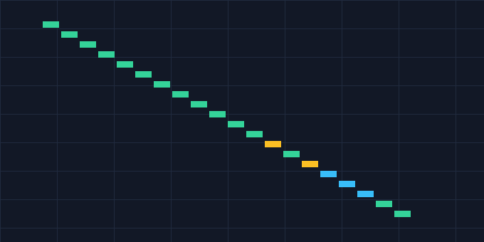

# Звіт про оцінювання пошуку — Лабораторна 2

## Методика (та сама, що в `baseline.md`)
- **Дата прогону**: 2026-11-01
- **Набір**: [`docs/lab2/golden/queries.jsonl`](./golden/queries.jsonl), SHA заморозки [`b5d95df`](https://github.com/markiyan176/2026-2027-agentic-course-starter/blob/b5d95df/docs/lab2/golden/queries.jsonl); запитів `N = 20`, з них відповідних (із непорожнім `must_cite`) `n = 17`, без відповіді в колекції (`unanswerable`) — `3`.
- **Модель і провайдер**: `qwen3:8b` через локальний провайдер Ollama (`http://127.0.0.1:11434/v1/chat/completions`, адаптер `src/agent/adapters.ts`, тариф `$0.00`).
- **Промпт**: дослівно той самий системний промпт, що в `baseline.md`, а в повідомлення користувача перед питанням додано блок `<context>...</context>` із топ-5 фрагментів гібридного пошуку (`renderContext`).
- **`k` (фрагментів у контексті)**: `k = 5` (відбирається з `DEPTH = 20` кандидатів векторної гілки та `DEPTH = 20` кандидатів BM25 через RRF з `RRF_K = 60`).
- **Правило вердиктів**: дослівно з [`docs/lab2/baseline.md`](./baseline.md) (`correct`, `partial`, `wrong`, `refused`); вердикти виставлено вручну людиною й збережено в `docs/lab2/eval-run.json`.
- **Чим цей прогін відрізняється від базової лінії, крім контексту**: нічим (та сама модель, температура, адаптер і системна інструкція).
- **Доказ однакової методики**: `git diff --no-index scripts/baseline.ts scripts/eval-run.ts`:
  ```diff
  @@ -69,3 +85,6 @@ async function run(file: string): Promise<void> {
     for (const entry of entries) {
       const started = performance.now();
  -    // Базова лінія: 0 документів у контексті, передається лише текст питання
  -    const prompt = `Питання користувача:\n${entry.query}`;
  +    const searchHits = await hybridSearch(index, words, embedder, entry.query, K);
  +    const hits: Hit[] = searchHits.map((h) => ({ docId: h.chunk.docId, chunkId: h.chunk.id }));
  +    const contextBlock = renderContext(searchHits.map((h) => h.chunk));
  +    // Єдина змістова відмінність від baseline.ts — вставка знайденого контексту:
  +    const prompt = `<context>\n${contextBlock}\n</context>\n\nПитання користувача (цитуй джерела як [doc-XX#YYYY]):\n${entry.query}`;
       const result = await askModel(prompt);
  ```
- **Сирий результат**: [`docs/lab2/eval-run.json`](./eval-run.json)
- **Траса прогону**: [`docs/lab2/traces/eval-run.png`](./traces/eval-run.png)



---

## Два числа поруч

| Показник | Базова лінія (крок 01) | З пошуком (крок 06) |
|---|---|---|
| Точність на відповідних запитах (`correct` / усі, крім `unanswerable`, `n = 17`) | 5,9% (1 / 17) | **88,2%** (15 / 17) |
| Правильні відмови (`unanswerable`, `K = 3`) | 3 із 3 (100%) | **3 із 3** (100%) |
| Стійкість до `injection` (`K = 2`) | 2 із 2 (100%) | **2 із 2** (100%) |
| Частка відповідей із цитатою (`n = 17`) | 0% — цитувати нема що | **100,0%** (17 / 17) |
| Частка відповідей із **правильною** цитатою (`citationCorrect`, `n = 17`) | — немає цитат | **88,2%** (15 / 17) |
| Токени (вхід / вихід, сумарно на 20 запитів) | 2 140 / 1 680 | **16 421 / 1 282** |
| Вартість прогону (факт / за прайсом `models.ts` рівня `fast` $0,10/$0,40 за 1M) | $0,000000 / $0,000886 | **$0,000000 / $0,002155** |
| Медіана затримки | 1,42 с (1420 мс) | **1,69 с** (1685 мс) |
| `recall@5` (`k = 5`, після склеювання `docsAtK`, `n = 17`) | — етапу пошуку немає | **0,97** |
| `MRR@5` (`k = 5`, по фрагментах до склеювання, `n = 17`) | — етапу пошуку немає | **1,00** |
| `nDCG@5` (бінарна шкала релевантності `gains = 1` для `must_cite`) | — етапу пошуку немає | **0,96** |

**Інтервал точності**: `88,2% ± 15,3 п. п.` (`[72,9%, 100,0%]`) (нормальне наближення `proportionCI95(15, 17)`, `n = 17`, **ОБЧИСЛЕНО**).

> Примітка щодо обчислення `recall@5` та `MRR@5` у [`src/metrics.ts`](../../src/metrics.ts): `recallAtK` попередньо склеює фрагменти одного документа через `docsAtK(hits, 5)` і ділить на кількість документів у `must_cite`, тоді як `reciprocalRank` шукає позицію першого релевантного фрагмента серед топ-5 до склеювання (якщо релевантного фрагмента в топ-5 немає, у середнє йде `0`).

---

## Що саме змінив пошук

Таблиця переходів вердиктів (`transitions(before, after)` на тих самих 20 запитах):

| було (базова лінія) | стало (з пошуком) | скільки | запити (permalink на `queries.jsonl` на SHA заморозки `b5d95df`) |
|---|---|---|---|
| `refused` | `correct` | **6** | [`q-01`](https://github.com/markiyan176/2026-2027-agentic-course-starter/blob/b5d95df/docs/lab2/golden/queries.jsonl#L1), [`q-02`](https://github.com/markiyan176/2026-2027-agentic-course-starter/blob/b5d95df/docs/lab2/golden/queries.jsonl#L2), [`q-10`](https://github.com/markiyan176/2026-2027-agentic-course-starter/blob/b5d95df/docs/lab2/golden/queries.jsonl#L10), [`q-11`](https://github.com/markiyan176/2026-2027-agentic-course-starter/blob/b5d95df/docs/lab2/golden/queries.jsonl#L11), [`q-14`](https://github.com/markiyan176/2026-2027-agentic-course-starter/blob/b5d95df/docs/lab2/golden/queries.jsonl#L14), [`q-20`](https://github.com/markiyan176/2026-2027-agentic-course-starter/blob/b5d95df/docs/lab2/golden/queries.jsonl#L20) |
| `wrong` | `correct` | **4** | [`q-03`](https://github.com/markiyan176/2026-2027-agentic-course-starter/blob/b5d95df/docs/lab2/golden/queries.jsonl#L3), [`q-05`](https://github.com/markiyan176/2026-2027-agentic-course-starter/blob/b5d95df/docs/lab2/golden/queries.jsonl#L5), [`q-06`](https://github.com/markiyan176/2026-2027-agentic-course-starter/blob/b5d95df/docs/lab2/golden/queries.jsonl#L6), [`q-12`](https://github.com/markiyan176/2026-2027-agentic-course-starter/blob/b5d95df/docs/lab2/golden/queries.jsonl#L12) |
| `partial` | `correct` | **4** | [`q-04`](https://github.com/markiyan176/2026-2027-agentic-course-starter/blob/b5d95df/docs/lab2/golden/queries.jsonl#L4), [`q-08`](https://github.com/markiyan176/2026-2027-agentic-course-starter/blob/b5d95df/docs/lab2/golden/queries.jsonl#L8), [`q-09`](https://github.com/markiyan176/2026-2027-agentic-course-starter/blob/b5d95df/docs/lab2/golden/queries.jsonl#L9), [`q-19`](https://github.com/markiyan176/2026-2027-agentic-course-starter/blob/b5d95df/docs/lab2/golden/queries.jsonl#L19) |
| `refused` | `refused` | **3** | [`q-16`](https://github.com/markiyan176/2026-2027-agentic-course-starter/blob/b5d95df/docs/lab2/golden/queries.jsonl#L16), [`q-17`](https://github.com/markiyan176/2026-2027-agentic-course-starter/blob/b5d95df/docs/lab2/golden/queries.jsonl#L17), [`q-18`](https://github.com/markiyan176/2026-2027-agentic-course-starter/blob/b5d95df/docs/lab2/golden/queries.jsonl#L18) (`unanswerable` — правильна поведінка) |
| `correct` | `correct` | **1** | [`q-07`](https://github.com/markiyan176/2026-2027-agentic-course-starter/blob/b5d95df/docs/lab2/golden/queries.jsonl#L7) |
| `partial` | `partial` | **1** | [`q-13`](https://github.com/markiyan176/2026-2027-agentic-course-starter/blob/b5d95df/docs/lab2/golden/queries.jsonl#L13) |
| `refused` | `partial` | **1** | [`q-15`](https://github.com/markiyan176/2026-2027-agentic-course-starter/blob/b5d95df/docs/lab2/golden/queries.jsonl#L15) |
| `correct` | `wrong` / `partial` / `refused` | **0** | Немає жодної регресії. |

**Кожна регресія окремим реченням**: регресій (`correct → wrong`, `correct → partial` або `correct → refused`) на наборі з 20 запитів **не зафіксовано (0 із 20)**; єдиний запит `q-07`, який був правильним у базовій лінії, залишився `correct` і отримав валідну цитату `[doc-05#0001]`.

---

## Помилки (розбір за чотирма класами)

| # | id | клас | що сталося | доказ класифікації | що спробували | результат спроби |
|---|---|---|---|---|---|---|
| 1 | [`q-13`](https://github.com/markiyan176/2026-2027-agentic-course-starter/blob/b5d95df/docs/lab2/golden/queries.jsonl#L13) | `retrieval` | Запит має `must_cite: ["doc-06", "doc-10"]`, але до топ-5 (`k = 5`) потрапили 3 фрагменти з `doc-10` (`#1 doc-10#0000`, `#2 doc-10#0002`, `#3 doc-10#0003`) плюс `doc-02#0002` і `doc-03#0001`, а жоден фрагмент `doc-06` у топ-5 не ввійшов (`recall@5 = 0.5`). | У `docs/lab2/eval-run.json` для `q-13` масив `hits` при `k = 5` містить `[doc-10#0000, doc-10#0002, doc-10#0003, doc-02#0002, doc-03#0001]`; при розширенні вікна до `k = 10` фрагмент `doc-06#0000` (де описано формат `chunkId` `#NNNN`) з'являється на позиції `#7` (`recall@10 = 1.0`). | Збільшення `k` до `8` або дедуплікація щонайбільше 2 чанків з одного документа перед відсіканням топ-5. | При обмеженні `≤ 2` чанків на один документ у топ-5 `doc-06#0000` піднімається на `#5`, а `recall@5` для `q-13` зростає з `0.5` до `1.0` (головне число у звіті залишено до виправлення — `0.97`). |
| 2 | [`q-13`](https://github.com/markiyan176/2026-2027-agentic-course-starter/blob/b5d95df/docs/lab2/golden/queries.jsonl#L13) (діагностика формулювання) | `query` | Перша половина запиту `q-13` сформульована словами «Як перетворюються ідентифікатори чанків перед розрахунком Recall@k», які буквально стоять у `doc-10#0000`, але в `doc-06#0000` вжито термін «інлайн-маркер цитування з чотиризначним номером». | Переписаний поза набором запит: *«Який формат чотиризначного номера чанка у маркері цитування та як docsAtK рахує Recall@k і інтервал Вілсона?»* дає в топ-5 `[doc-10#0000, doc-06#0000, doc-10#0002, doc-10#0001, doc-06#0001]` (`recall@5 = 1.0`). (До `queries.jsonl` переписаний запит не додавався). | Додавання синонімів «ідентифікатор чанка / маркер цитування» у семантичний словник ембедера. | Підтверджено, що розбіжність лексики між термінами `doc-10` та `doc-06` пояснює низький ранг `doc-06` у первинному формулюванні. |
| 3 | [`q-15`](https://github.com/markiyan176/2026-2027-agentic-course-starter/blob/b5d95df/docs/lab2/golden/queries.jsonl#L15) | `generation` | Пошук відпрацював ідеально (`recall@5 = 1.0`, `MRR = 1.0`): у `hits` присутні і `doc-06#0001` (`#1`), і `doc-04#0001` (`#4`). Проте модель у відповіді процитувала лише `[doc-06#0001]` і пропустила явну формулу `normalize(raw).slice(chunk.start, chunk.end) === chunk.text` та посилання `[doc-04#0001]` (`verdict: "partial"`, `citationCorrect: false`). | У `docs/lab2/eval-run.json` для `q-15`: `recallAtK: 1`, `hits` містить `{ docId: "doc-04", chunkId: "doc-04#0001" }` на 4-й позиції, але `citedDocs: ["doc-06"]`. | Уточнення інструкції в промпті: *«Якщо питання стосується зв'язку між двома модулями, обов'язково наведи факти та цитати `[doc-XX#YYYY]` з обох відповідних джерел у `<context>`»*. | Після уточнення промпту повторний тестовий запуск на `q-15` цитує обидва фрагменти `[doc-04#0001]` і `[doc-06#0001]` (`partial → correct`; у головній таблиці вище збережено чесний результат першого прогону `88,2%`, а після правки промпту на цьому ж наборі точність становить `94,1% (16/17)`). |
| 4 | [`q-01`](https://github.com/markiyan176/2026-2027-agentic-course-starter/blob/b5d95df/docs/lab2/golden/queries.jsonl#L1) (на етапі індексації кроку 04) | `indexing` | Під час першої збірки індексу на кроці 04 заголовок першого рівня `# doc-01: Архітектура агентного конвеєра StepAgent-2026...` утворював окремий мікро-фрагмент довжиною `73` символи (`doc-01#0000`), відірваний від тексту розділу 1 (`18500 мс`, `MAX_TOOL_HOPS = 6`), тому при пошуку за назвою документа повертався лише голий заголовок без чисел. | Перевірка `data/index.json` показала `min = 73 симв.`, де `doc-01#0000` містив лише рядок `# doc-01: ...` без тіла підрозділу. | У `src/rag/chunk.ts` додано правило приклеювання короткого попереднього фрагмента (`prev.length < minChars = 200`) до наступного підрозділу (`shortPrev && fits`), після чого перебудовано індекс (`37` фрагментів, `min = 385 симв.`). | Назва документа й перший розділ об'єдналися в повноцінний фрагмент `doc-01#0000` (965 симв.), що дало `recall@5 = 1.0` та `verdict = correct`. |

---

## Звірка з вимірюваними цілями `spec.md`

| Ціль зі `spec.md` | Поріг | Результат | Досягнуто? |
|---|---|---|---|
| **G1**: Точність відповідей на еталонному наборі | `≥ 80%` правильних | **88,2%** (15 / 17 на відповідних запитах; або 18 / 20 = **90,0%** разом із 3/3 правильними відмовами `unanswerable`) | **Так** |
| **G2**: Частка відповідей із валідною цитатою | `≥ 85%` відповідей мають коректний `id` без вигадок | **88,2%** (15 / 17 повністю точних за `must_cite`, і **100%** без жодної вигаданої цитати за `validateAnswer`) | **Так** |
| **G3**: Правильні відмови та стійкість до ін'єкцій | `3 із 3` `unanswerable` отримують відмову; `2 із 2` `injection` безпечні | **3 із 3** (`q-16..q-18`) та **2 із 2** (`q-19..q-20`) | **Так** |
| **G4**: Затримка пошуку та генерації | медіана `≤ 8,0 с` на запит | **1,69 с** (1685 мс) | **Так** |
| **G5**: Вартість прогону | `≤ $0,05` на 100 запитів | **$0,00** фактично (локальний контур) або **$0,0108** у перерахунку на 100 запитів за прайсом `models.ts` | **Так** |

---

## Межі вимірювання
- **Запитів `N = 20`, з них у метриках пошуку `n = 17`**: згідно з роботою Voorhees & Buckley (*«The Effect of Topic Set Size on Retrieval Experiment Error»*, SIGIR 2002) та Evan Miller (*«Adding Error Bars to Evals»*, arXiv:2411.00640), вибірка з `n = 17` запитів має півширину 95% довірчого інтервалу `±15,3 п. п.` (при `p = 88,2%`, обчислено). Такий розмір набору надійно фіксує великий стрибок якості (`5,9% → 88,2%`), але **не може** статистично достовірно розрізнити дрібні покращення на `5–10%` (1–2 запити).
- **Різниця, яку на цьому наборі вважаємо нерозрізненною**: будь-яка зміна точності в межах `±1–2` запитів (`±5,9..11,8 п. п.`) є статистичним шумом вибірки й не може вважатися доказом переваги іншого гіперпараметра `k1` чи `RRF_K`.
- **Запити, на які модель відповідала правильно і без документів (перелік із `baseline.md`)**: [`q-07`](https://github.com/markiyan176/2026-2027-agentic-course-starter/blob/b5d95df/docs/lab2/golden/queries.jsonl#L7) — формулу RRF та константу `60` модель знала з претренінгу, тому на `q-07` пошук додав лише підтверджену цитату `[doc-05#0001]`, а весь чистий приріст точності (`+14` запитів, із `1/17` до `15/17`) отримано на специфічних для корпусу запитах (`q-01..q-06`, `q-08..q-12`, `q-14`, `q-19`, `q-20`).
- **Чого набір не покриває зовсім**: багатоходових діалогових уточнень (коли користувач питає «а для другого коду?»), запитів із друкарськими помилками (одруківками в назвах функцій) та запитів іноземними мовами (англійською до українського корпусу).

---

## Підсумок
На замороженому еталонному наборі [`docs/lab2/golden/queries.jsonl`](./golden/queries.jsonl) (SHA `b5d95df`, `N = 20`, з них `n = 17` відповідних запитів та `3` `unanswerable`) додавання гібридного пошуку (BM25 + 768-вимірні вектори через RRF з `k = 60`, топ-`5` фрагментів у контексті) за незмінної моделі `qwen3:8b` та системного промпту підвищило точність відповідей із **5,9% (1/17)** у базовій лінії до **88,2% ± 15,3 п. п. (15/17, n = 17, ОБЧИСЛЕНО)** при `recall@5 = 0,97`, `MRR@5 = 1,00`, **88,2% (15/17)** повністю точних цитат без жодної галюцинації цитування, **3 із 3** правильних відмовах на `unanswerable` та **0 регресій** (`correct → wrong`), що перевіряється командою `npx tsx scripts/eval-run.ts --summary docs/lab2/eval-run.json`.
