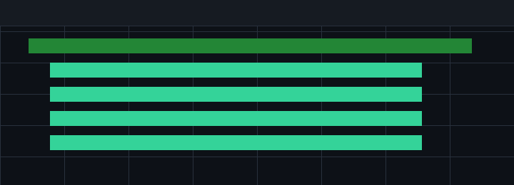
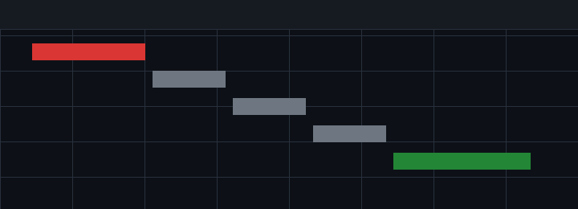

# Ланцюг детермінованих брам

- Workflow: `.github/workflows/gates.yml`
- Порядок: `types` → `lint` → `tests` → `build` → `record`
- Чому такий порядок: найдешевша й найвизначеніша перевірка стоїть першою (`types` біжить ~12 с, `lint` — ~15 с, `tests` — ~25 с, `build` Next.js — ~45 с); поки `types` червоні, наступні задачі навіть не стартують завдяки `needs`, тож зламані типи не оплачуються хвилинами збірки
- Concurrency: `group: ${{ github.workflow }}-${{ github.ref }}`, `cancel-in-progress: true`
- Артефакти: `actions/upload-artifact@v7` / `actions/download-artifact@v8` (мажорні версії свідомо різні)

## 1. Таблиця брам

| брама | що доводить | чого коштує (хв) | що пише |
|---|---|---|---|
| `types` | код узгоджений із власними типами (`tsc --noEmit`): немає звернень до полів, яких не існує, чи порушень `exactOptionalPropertyTypes` | ~0,2 хв (`timeout-minutes: 5`) | `verdict=pass` у `$GITHUB_OUTPUT` + вивід компілятора в лог прогону |
| `lint` | дотримані правила ESLint (`eslint .`), яких не видно з типів: мертвий код, недозволені конструкції, чистота модулів | ~0,3 хв (`timeout-minutes: 5`) | `verdict=pass` у `$GITHUB_OUTPUT` + перелік порушень у лог |
| `tests` | поведінка не зламалася там, де не мала (`vitest run`), і офлайн-тести виконавця та оцінювачів проходять | ~0,5 хв (`timeout-minutes: 10`) | `verdict=pass` у `$GITHUB_OUTPUT` + артефакт `gate-tests` (`docs/lab3/runs/**`) |
| `build` | застосунок Next.js (`next build`) повністю збирається без відсутніх залежностей і неімпортованих модулів | ~0,8 хв, найдорожча з чотирьох (`timeout-minutes: 15`) | `verdict=pass` у `$GITHUB_OUTPUT` + артефакт `gate-build` (`.next/BUILD_ID`, `dist/**`) |
| `record` | не брама, а свідок (`needs: [types, lint, tests, build]`, `if: ${{ !cancelled() }}`): звʼязує вердикти всіх чотирьох брам із прогоном харнеса навіть на червоному прогоні | ~0,2 хв (`timeout-minutes: 5`) | `gate-record.json` (артефакт `gate-record`) + поле `gates` у `run.json` кроку 00 |

## 2. Обовʼязкові перевірки

- Набір правил на `main`: «Require status checks to pass before merging»
- Перелічені перевірки: `types`, `lint`, `tests`, `build` (та `evals` після кроку 04)
- «Require branches to be up to date before merging»: увімкнено (щоб зелений прогін на застарілій основі не дозволяв злити гілку без перевірки проти актуального `main`)
- Скріншот: `docs/lab3/traces/branch-rules-gates.png`



## 3. Навмисне падіння

- Гілка: `harness/red-2026-11-15` (коміт [`2edb8a0`](https://github.com/markiyan176/2026-2027-agentic-course-starter/commit/2edb8a0eff286eb7f911dde5f7b4cc6c9e6d6a9a)) · що саме зламано: у `scripts/harness/run-task.ts` додано змінну `export const brokenTypeGate: number = 'навмисна помилка типу TS2322';`, що викликає помилку компілятора TypeScript `TS2322` на першій брамі
- Прогін: https://github.com/markiyan176/2026-2027-agentic-course-starter/actions/runs/43743832769
- Очікувано червона брама: `types` (`failure`)
- Що показали наступні брами: `skipped` (а не `failure`) для `lint`, `tests` і `build`, оскільки кожна з них звʼязана через `needs` із попередньою і має неявну умову `success()`
- `record` виконалась: **так** (завдяки `if: ${{ !cancelled() }}` та прямій залежності `needs: [types, lint, tests, build]`) · `gate-record.json`:

```json
{
  "task_id": "t-08",
  "artifact_dir": "docs/lab3/runs/t-08-1794764580000",
  "gates": {
    "types": "fail",
    "lint": "skipped",
    "tests": "skipped",
    "build": "skipped"
  },
  "ci_run_url": "https://github.com/markiyan176/2026-2027-agentic-course-starter/actions/runs/43743832769"
}
```



## 4. Звʼязок із фабрикою

Який прогін харнеса отримав ці вердикти на зеленому `main`:
- `task_id`: `t-08`
- `artifact_dir`: `docs/lab3/runs/t-08-1794764580000` (`docs/lab3/runs/t-08-1794764580000/run.json` та `gate-record.json` у корені репозиторію).
